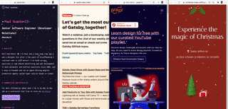

Hello there,

On Friday, after kind of a rough week, I decided to code something just for fun! And fun was had, I hereby present to you [@raae/gatsby-plugin-let-it-snow](https://github.com/queen-raae/gatsby-plugin-let-it-snow).

❄️❄️❄️

A throwback to my days with WordPress.\
(If you know you know... 👵)

Feel free to [contribute with code or feature requests](https://github.com/queen-raae/gatsby-plugin-let-it-snow/issues)!

Pirate Paul jumped on board straight away. His [first Pull Request](https://twitter.com/PaulieScanlon/status/1460185706740035586) added support for colored snow, practical if your background is white or you want to be more on-brand (like Paul on [paulie.dev](https://paulie.dev/))

All the best,\
Queen Raae

PS: Make sure to tag me on Twitter (@raae) if you take it for a spin.
