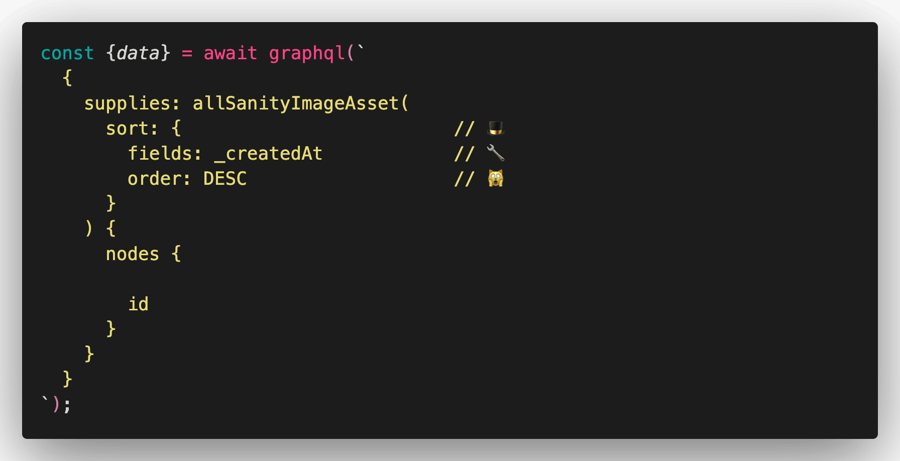
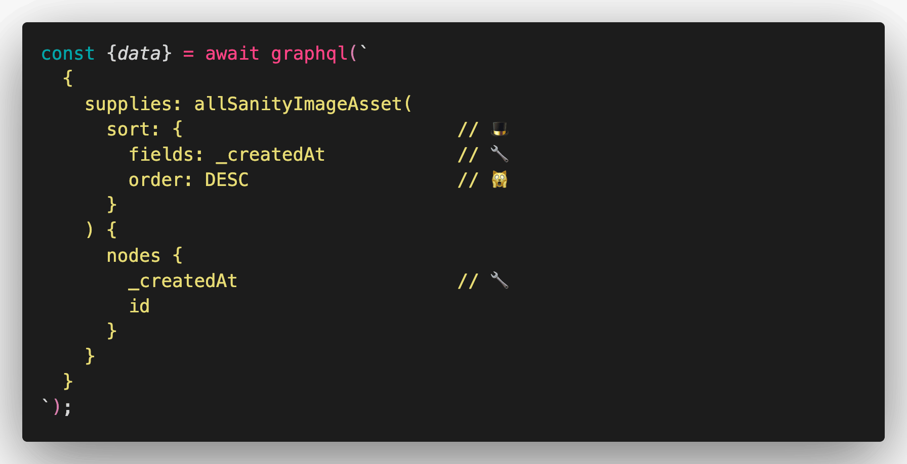
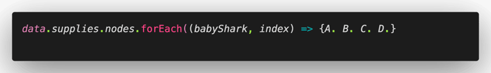
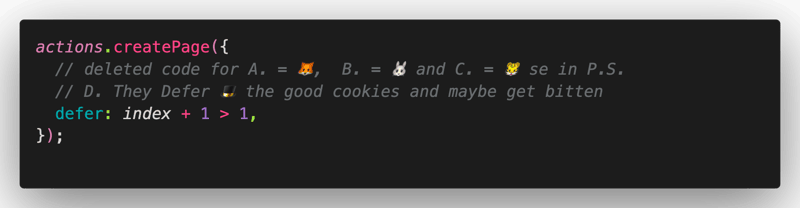
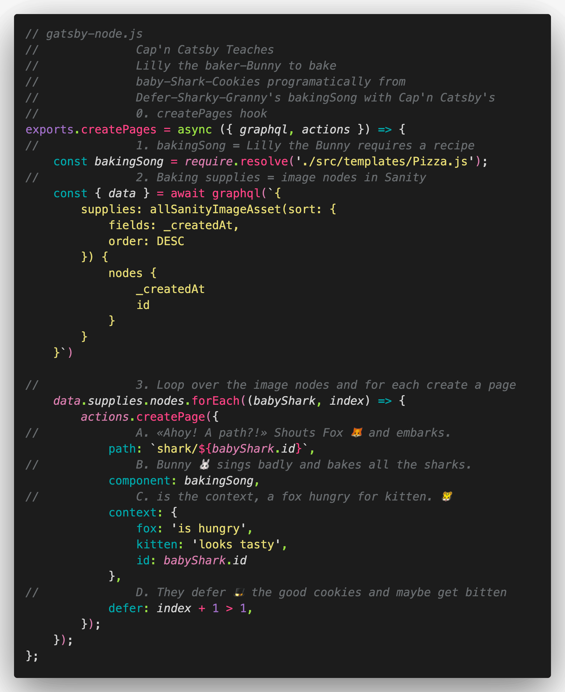

Ship Ahoy Skill Builder!

**One of my tiny tasks this week was:**

– Try DSG inside gatsby-node.js

I'll be streaming unsupervised again tonight at 20:00 CET over on the [Queen's YouTube Channel](https://www.youtube.com/channel/UCDlrzlRdM1vGr8nO708KFmQ)...**What did I do?**

I did DSG in my TimeShip Gatsby website.\
Check the P.S. for my finished code.

**Why did I do it?**

I want the latest image page to show up fast and all the older image pages to be generated when a user goes to the url to look at each image page.

Because it fits into the tall tale / children’s coloring book I am working on with Lillian (6 🏴‍☠️👸). We want to show the badly baked gingerbread sharks to _ _ _ “Whitey” Fox, so she will not eat all the good gingerbread sharks. Bad idea…. More about that sometime in the future.

**How did I do it?**

1. I opened gatsby-node.js and set my timer for 1 hour and 36 minutes.

2. I added 🎩 sort: {🎩, 🙀} to my graphql query inside GraphiQL first to get the proper syntax

3. I typed it up 🎩 sort: {🔧, 🙀} in my graphql query inside gatsby-node.js

4. I added 🔧 _createdAt to my graphql query

5. I added index to my forEach(🦈)

6. I added defer: index + 1 > 1, to my createPage({ A. = 🦊, B. = 🐰, C. = 🐯, D. = 🎩 })

7. I build the code and get this in my terminal-Tor:

![// gatsby-node.js // Cap'n Catsby Teaches // Lilly the baker-Bunny to bake // baby-Shark-Cookies programatically from // Defer-Sharky-Granny's bakingSong with Cap'n Catsby's // 0. createPages hook exports.createPages = async ({graphql, actions}) => { // 1. bakingSong = Lilly the Bunny requires a recipe const bakingSong = require.resolve("./src/templates/Pizza.js"); // 2. Baking supplies = image nodes in Sanity const {data} = await graphql(` { supplies: allSanityImageAsset(sort: {fields: _createdAt, order: DESC}) { nodes { _createdAt id } } } `); // 3. Loop over the image nodes and for each create a page data.supplies.nodes.forEach((babyShark, index) => { actions.createPage({ // A. «Ahoy! A path?!» Shouts Fox 🦊 and embarks. path: `shark/${babyShark.id}`, // B. Bunny 🐰 sings badly and bakes all the sharks. component: bakingSong, // C. is the context, a fox hungry for kitten. 🐯 context: { fox: "is hungry", kitten: "looks tasty", id: babyShark.id, }, // D. They defer 🎩 the good cookies and maybe get bitten defer: index + 1 > 1, }); }); };](./image-5.png)

This means only one page is NOT deferred and that is the page created from my newest image. All older images are on deferred pages. 🎩

8. I did “undo” until my new code was gone

9. I re-coded the code in steps 2. to 5.

10. I re-coded the code in steps 2. to 5.

11. I re-coded the code in steps 2. to 5.

12. I re-coded the code in steps 2. to 5.

Keep your skill-building-submarine afloat this week!\
🔧⛵🏴‍☠️

Ola Vea Gatsby Piraty Captain

**PS:** Full code

