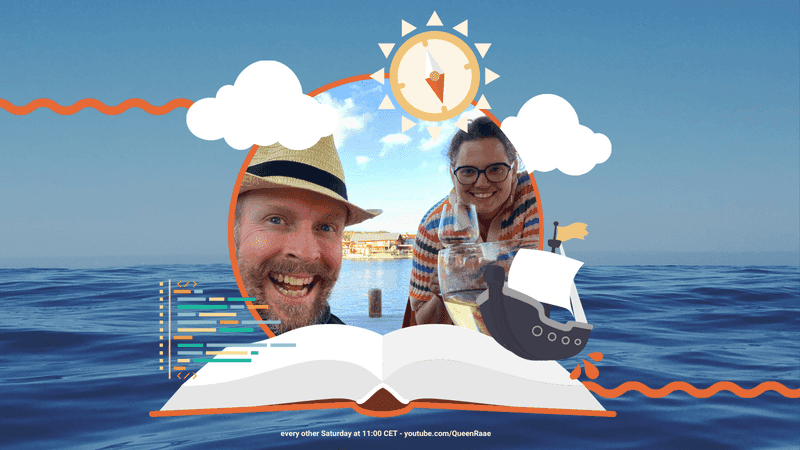
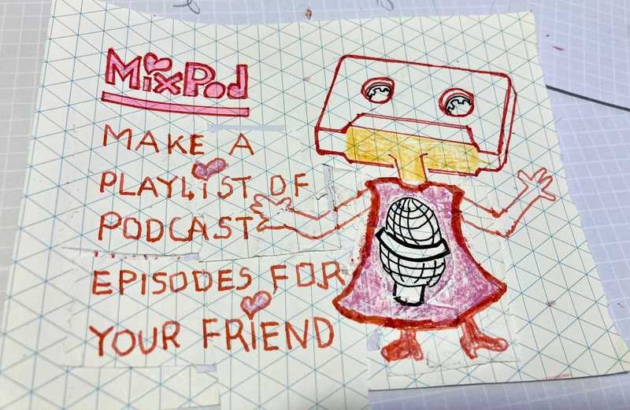

Hello there,

We may have been sailing in silence for a while...but our adventures through the high seas of the World Wide Web never stopped 🌊

I'm writing because a new idea is brewing, and at some point, you signed up for news from Lilly Labs, aka. The piratical family, aka. Lillian, Benedicte, and Ola 🏴‍☠️

Here is the link to unsubscribe from our sporadic emails; no hard feelings.

The new idea is MixPod, and we'd love to see you in the chat [tomorrow (Saturday) at 11:00](https://www.youtube.com/QueenRaae/live) CET on YouTube for our second voyage of this particular Treasure Hunt.

We'll keep you updated sporadically so as not to overwhelm your inbox. But if you'd like to get an email 30 minutes before we go live every other week...

[**Subscribe to our reminder emails 🔔**](https://queen.raae.codes/emails/preferences/)

### **What's MixPod, you might wonder?**

Think of it as mixtapes but for podcast episodes...

All the best,\
Queen Raae

PS: [Outseta](https://outseta.com/) is MixPod's first sponsor, and we are looking for more sponsors to join the fleet. If you're ready to embark on this exciting journey with us, hit reply!
