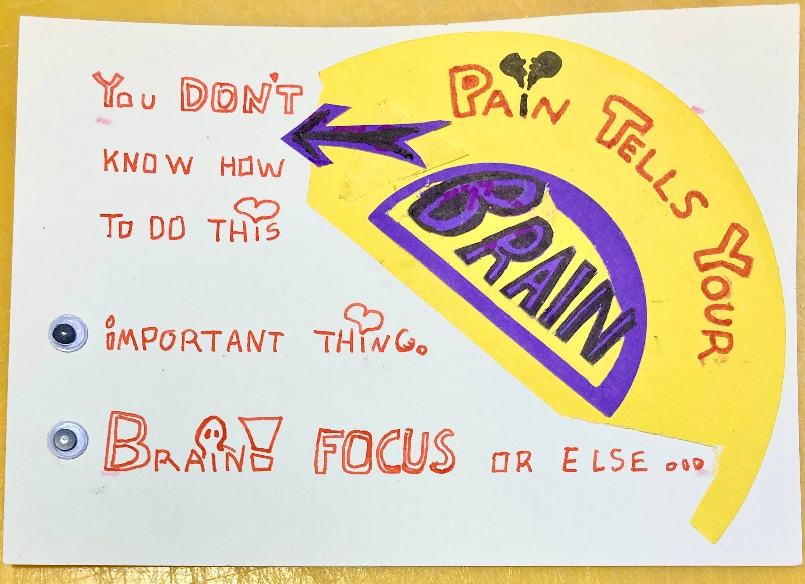

Ahoy Shipmate,

Last week, Cassidy Williams wrote [Kind of annoyed at React](https://blog.cassidoo.co/post/annoyed-at-react/), and I wholeheartedly agree with her train of thought.

In it, she mentioned that the latest React release was in [June 2022](https://github.com/facebook/react/releases/tag/v18.2.0) 🤯

That made me peek at the release note again, reminding me that React Server Components (RSC) are still experimental.

And together with experiences like:

> Every time a new developer picked up our codebase, the questions came up: “What’s running on the server? What’s running on the client?” Every PR had feedback regarding something accidentally/unnecessarily shipped to the client.

mentioned in [Everything I Wish I Knew before moving 50,000 lines of code to React Server Components](https://www.mux.com/blog/what-are-react-server-components) it makes me cautious, very cautious.

But it's always a good idea to try to understand a concept, and for that, I recommend Josh Comeau's post [Making Sense of React Server Components](https://www.joshwcomeau.com/react/server-components/).

🤔

### **Upcoming Voyage**

Could [The Tiny Stack](https://logsnag.com/blog/the-tiny-stack) (Astro, SQLite, Litestream), be a fit for MixPod?

🗓️ Saturday 11:00 CET\
📺 [Live on YouTube](https://www.youtube.com/QueenRaae/live)

### **Crew Highlights**

🎙️ Recorded and published the first [Slow&Steady episode](https://www.slowandsteadypodcast.com/episodes/holidays-birthday-bonanzas-and-2024-goals) of the year.

🆘 The first [Gatsby Emergency Call](https://queen.raae.codes/gatsby-emergency/) of the year is in the books.

📈 After working with Outseta in 2023, my [ownership is 0.89%](https://www.outseta.com/posts/outseta-seven-year-update).

📝 Captain Ola published [Do YOU practice your dev-task like you bake a chocolate muffin](https://www.olavea.com/blog/2024/01/11-practice-your-dev-task-like-you-bake-a-chocolate-muffin/).

💃 I danced my a\*\* off at my 40+1 party; here's [photo proof.](https://twitter.com/raae/status/1746931143230783594)

🎬 The Pirate Princess did her first (only?) paid gig of the year, participating in an infomercial for the Munch Museum in Oslo.

### **Around the Interwebz**

💌 [weird wide web hole](https://buttondown.email/weirdwidewebhole) — Salma (whitep4nth3) asks "Want weird stuff in your inbox?" and your answer should be "Yes, please!"

🛠️ [mmm.page](https://mmm.page) — A different kind of website builder that I highly recommend. Their tagline, "Websites don’t have to be so cookie cutter," is spot on.

📺 [If Pixar Made Programming Tutorials](https://www.youtube.com/watch?v=6TYkDy54q4E) — I enjoyed how he breaks down the feature into small manageable chunks.

*From [Do YOU practice your dev-task like you bake a chocolate muffin](https://www.olavea.com/blog/2024/01/11-practice-your-dev-task-like-you-bake-a-chocolate-muffin/) by Ola*

All the best,\
Queen Raae

PS: You're part of our crew; so send me your highlights before January 31st, and I'll include them in the next Queen's Log.
