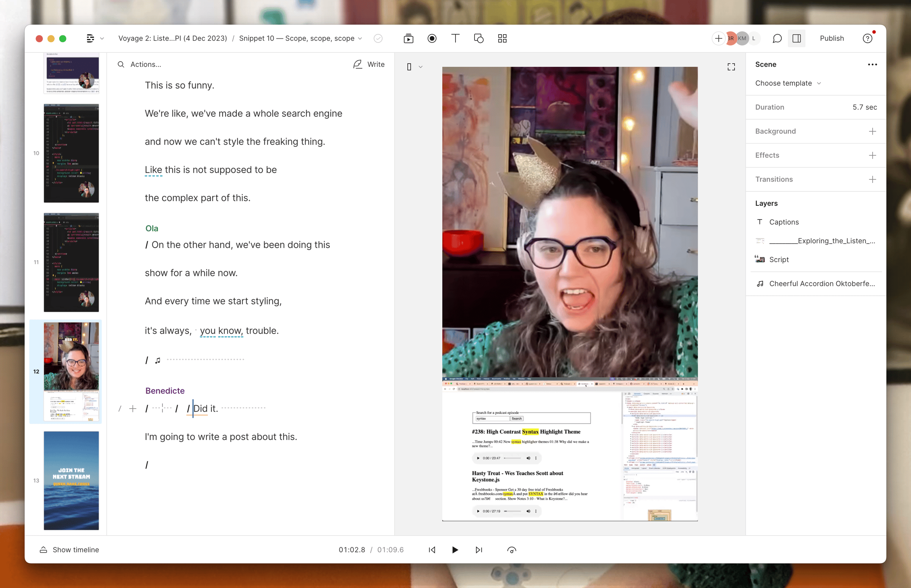

Ahoy Shipmate,

Always ask for numbers when someone wants your help with a web project that needs to be able to scale.

- How many users?
- How many transactions?
- How many uploads?

Even a company with all of the Norwegian population (5.4 million) as its possible customer base will never get close to what an Amazon or a Spotify would need in terms of scale.

When I asked, "How many customers are we talking about scaling to in the next three years, best case?" in a meeting this week, the answer was 900.

900 customers with no uploads, posts, or multiple transactions per customer, and all traffic to the site is coming from within Norway. Maybe not all; someone might log in while on vacation. But you get my point.

All the buzzwords are void.

No need for replications of edge functions across the globe, no need to handle 1000s of simultaneous requests, no need for real-time SDK, and the list goes on.

🤔

**Upcoming Voyage**

Let's get started making playlists from UI to DB.

🗓️ Saturday at 11:00 CET\
📺 [Live on YouTube](https://www.youtube.com/QueenRaae/live)

### **Crew Highlights**

🤪 Learned that being good at [AWS is not my jam](https://www.youtube.com/shorts/JgLCREL3_uA).

🛠️ Managed to get Litestream working with Cloudflare R2 instead after stream, resulting in some [Tiny Stack pull requests](https://github.com/Sh4yy/tiny-stack/pulls?q=is%3Apr+author%3Araae+).

📝 Captain Ola published [Personalized Skill-Building Techniques](https://www.olavea.com/blog/2024/01/21-personalization-and-skill-building/).

🎁 Helped hype the launch of our [new Outseta Webflow App](https://www.outseta.com/posts/outsetas-new-webflow-app).

👩‍💻 Published [code snippets](https://go.outseta.com/support/kb/categories/rm0Ak4QX/code-snippets) to customize and extend the capabilities of Outseta.

🍩 Celebrated the Pirate Princess' 9th birthday "tre dager til ende" starting with a donut breakfast. You may view [the happy parents and the donuts](https://twitter.com/OlaHolstVea/status/1750472331217031188) on Twitter.

### **Around the Interwebz**

💡 [once.com](https://once.com/) — 37Signals started selling pay-once self-hosted software, in opposition to the typical SaaS model of the day. Starting with a Slack competitor.

🛠️ [webhook.site](https://webhook.site/) — An excellent tool for testing webhooks, an often vital part when integrating with third-party tools such as Stripe or Outseta.

📺 [10 very promising Open Source Projects you haven’t heard of](https://www.youtube.com/watch?v=qXUl3VsbA6o) by Fireship — many great projects that could work for your next project.

*This is me sober, I promise 🤣 Streaming is just that much fun!*

All the best,\
Queen Raae

PS: You're part of our crew! Send me your highlights, and I'll include them in the next one.
