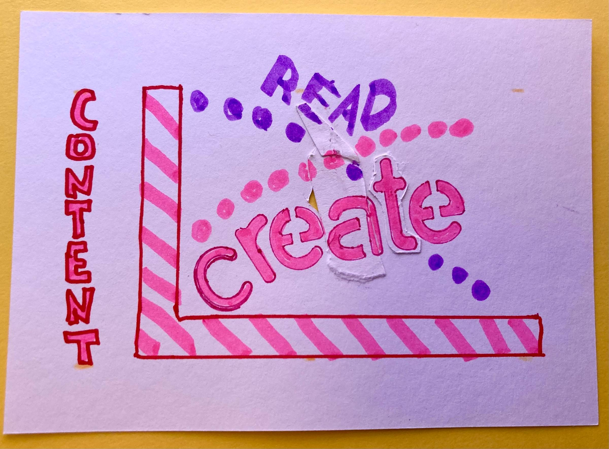

Ahoy Shipmate,

We are considering using MixPod as a study to see how far we can get with no client-side JavaScript—forcing us to use, at this point, unfamiliar patterns. But patterns that used to be all I knew way back when.

What do you think?\
Is it an **interesting** or **futile** idea?

🤔

### **Upcoming Voyage**

🎯 Add an episode to a playlist\
🗓️ Saturday at 11:00 CET\
📺 [Live on YouTube](https://www.youtube.com/QueenRaae/live)

### **Crew Highlights**

🎁 Beta of the requested [gatsby-transformer-cloudinary feature is out](https://www.npmjs.com/package/gatsby-transformer-cloudinary/v/4.6.0-beta.1); if you use headless cms + gatsby + cloudinary please test and let me know how it goes.

📹 Captain Ola vlogged [with the wrong audio input,](https://youtube.com/shorts/GKUTw7WolL0) and another with a [mirrored sketch note](https://www.youtube.com/shorts/Utg04q6a8Pw). The only way to get good is to get started!

📖 Convinced Geoff at Outseta to read the excellent [Docs for Devs](https://docsfordevelopers.com/), and he [even published notes](https://www.outseta.com/posts/docs-for-developers) from the book.

⭐ The Pirate Princess starred (or, more correctly, her new Insta 360 Ace Pro camera) in a [YouTube short](https://www.youtube.com/shorts/GXQBF9XWSyA) that is our most viewed video by far this year.

### **Around the Interwebz**

💡 [bootcamp.dev](https://bootcamp.dev/) — I've heard good things about Flavio's boot camps, and enrollments just opened for the 2024 cohort.

🛠️ [Xano](https://www.xano.com/) — "The No-Code Backend to Power and Scale any App." After my initial skepticism, I realized this tool is such a powerhouse. Super impressed!

📺 "When I said I'd do anything for you, this is anything." - Mat Damon [in the funny Superbowl](https://www.youtube.com/watch?v=Ve2miT5iF2M) ad that had Ola and me reminiscing about our days in Boston.

*The non-mirrored graph from [Ola's You Tube Short](https://www.youtube.com/shorts/Utg04q6a8Pw) on the topic*

All the best,\
Queen Raae
