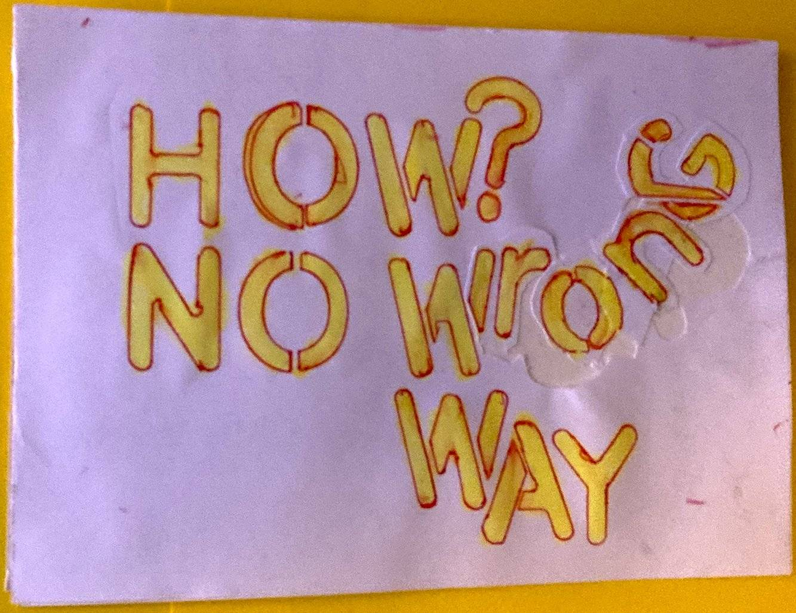

Ahoy Shipmate,

I signed up for [Amy's inaugural Two-Week Build Challenge](https://www.twoweekbuild.com/). And there is still time for you to sign up!

Let me know if you need some added accountability. We could set up co-working sessions 🎉

**How It Works**

- Pick Something to Build
- Build it in 2 Weeks
- Ship it

**Rules and Guidelines**

- Have fun.
- Don’t overthink it.
- Don’t start until March 1, 2024.
- You can build anything. Write an ebook. Design a UI library. Build a web application.
- At the end of 2 weeks, ship what you have.

I'll build a website for Data in the Wild Podcast as we'll be relaunching Season 1 in April now that all episodes are recorded.

And I plan on live streaming every day starting [Monday, the 4th](https://www.youtube.com/watch?v=YVVbxpL0iv8).

But if I fold or skip some, that is also okay...

👷‍♀️

### **Upcoming Mix Pod Voyage**

🎯 No login required\
🗓️ Saturday at 11:00 CET\
📺 [Live on YouTube](https://www.youtube.com/QueenRaae/live)

### **Crew Highlights**

🏴‍☠️ Ola wrote about the [unblocking powers of Pirate Pages](https://queen.raae.codes/emails/2024-02-29-pirates-pages-are-weirdly-unblocking/)

💬 [Tobias pulled up a quote of mine from yesteryear.](https://x.com/raae/status/1762784662571614653?s=20)..

🆘 [Emergency Calls](https://queen.raae.codes/emergency/) are no longer specific to Gatsby for those times you are stuck on a reef in the sharky waters of the World Wide Web.

📺 We hung out with William, CEO of Hackmamba (Content Agency), and Ola caught [me cooking toast on tape](https://www.youtube.com/shorts/IM2G5ypdnT4) (or "on hard drive"?)

♾️ Building a service for DevTool Service where you [go live with me by your side](https://twitter.com/raae/status/1762218441296003131) twice a month and never run out of content for your social media feeds.

🤖 We're [betting against AI](https://x.com/SlowSteadyPod/status/1762764981194338630?s=20) 💪

### **Around the Interwebz**

💡 CSS-only [animated tab interaction](https://twitter.com/jh3yy/status/1746099478656901617) using CSS :has() by @jh3yy, CSS Wizzard!

🛠️ [Convex](https://www.convex.dev/) looks like a cool real-time database service.

🎙️ [Postgres.fm](https://postgres.fm/) is the podcast for those interested in Postgres.

*There is no wrong way of [doing Pirate Pages](https://queen.raae.codes/emails/2024-02-29-pirates-pages-are-weirdly-unblocking/)*

All the best,\
Queen Raae
