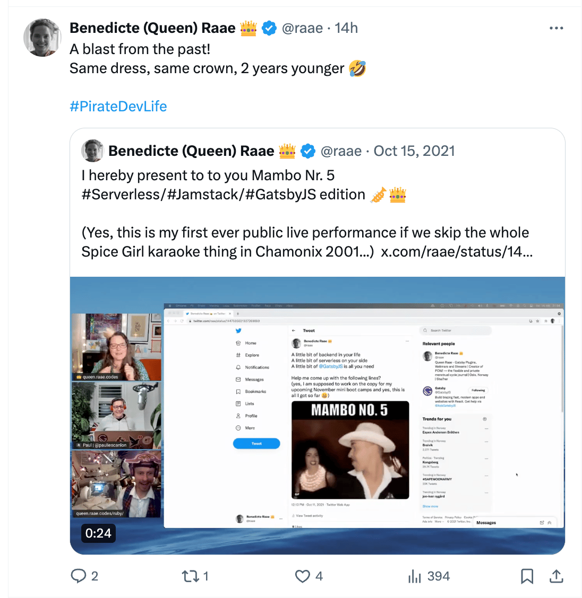
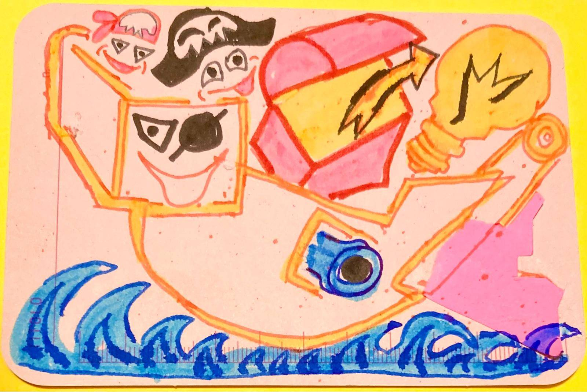

Ahoy Shipmate,

After streaming every business day for two weeks, I am exhausted. But also weirdly energized and as full of ideas as I was on the [last recording of Slow&Steady](https://www.slowandsteadypodcast.com/episodes/go-live-with-queen-raae) almost two weeks ago!

The ideas are flowing; morale is high!

However, this is all you're getting as an intro, as I need to fit in some outside time before [today's #TwoWeekBuild stream](https://www.youtube.com/live/ls6yPOD6yAk?si=ZcqmQdW72Ei4ljx4) so my brain is not permanently scarred from too much screen time...

🤣

### **Upcoming Mix Pod Voyage**

🎯 No login required; continued\
🗓️ Saturday at 11:00 CET\
📺 Live on [YouTube](https://www.youtube.com/@QueenRaae/streams) and [Twitch](https://www.twitch.tv/queenraae) (yes!)

### **Crew Highlights**

🏴‍☠️ We got [raided on Twitch](https://www.twitch.tv/videos/2090458970?t=00h36m28s) by Salma (whitep4nth3r) and did not know what hit us...but Ola and the Pirate Princess improved a raid song!

✨ Ola took a pass at the [sales page for live streams](https://deploy-preview-177--queen-raae-codes.netlify.app/consistent-clips/) as a vehicle for **consistent clips** that will get your dev tool users to trust you more.

📝 I published a post on [Astro Remote Collections (sort of)](https://queen.raae.codes/2024-03-11-remote-astro-collections/) to get good DX for remote data that seems to have hit a note.

💬 We became a family that communicates with [voice memos through YT Shorts](https://youtube.com/shorts/ks1H0XT_1jM?feature=share).

📺 Salma (whitep4nth3r) published a great video on [stupid reasons stopping her from making videos](https://youtu.be/ma9cRUkfiSQ?si=9YSeIXHJGSpwuklx). Give it a comment if you recognize yourself in any of them!

### **From the archives**

Once I [sang karaoke live](https://x.com/raae/status/1768361274167988237?s=20) on stream...

### **Around the Interwebz**

💡 [Taylor Swift thinks journaling](https://www.tiktok.com/@xorcontent/video/7249700931430911258) helps you understand how you feel and makes it less overwhelming - so do those [Pirate Pages](https://queen.raae.codes/2024-02-29-pirates-pages-are-weirdly-unblocking/).

🛠️ [val.town](https://www.val.town/) **—** "If GitHub Gists could run And AWS Lambda was fun." I love this tagline and I really hope to have some time to explore it soon.

📺 [Why YouTubers hold microphones now](https://www.youtube.com/watch?v=0arvnAlV_C4) **—** It's an hour long, but it has some great insights into the direction of YouTube content that applies also to socials.

All the best,\
Queen Raae
