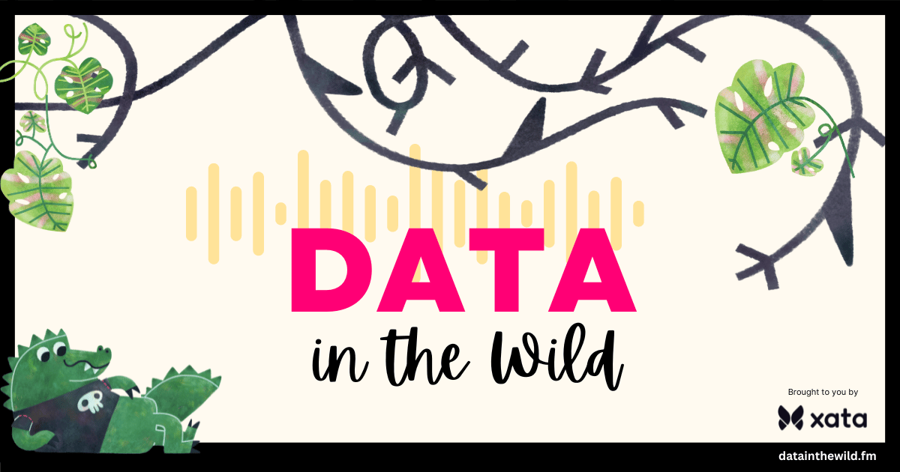
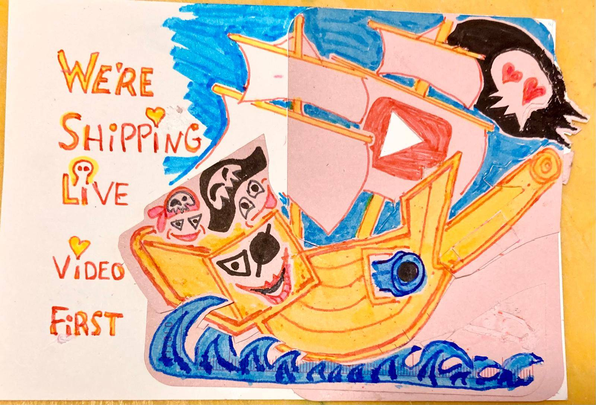

Ahoy Shipmate,

We are gearing up for the launch of [Data in the Wild](https://www.datainthewild.fm/)! A podcast brought to you by Xata with yours truly as hosts and podcast brand designers 🤪

Learn from your favorite indie hackers as they share hard-earned lessons and *tall tales* from their data model journeys!

Sign up on [datainthewild.fm](https://www.datainthewild.fm/) to be notified when episodes are released.

We'd also love to do a season 2 where we deep dive into proven data structures/design/models for specific features such as comments, tags + categories, organization vs. user, etc.

We are actively looking for a sponsor or sponsors. If you have a contact at Supabase, Appwrite, Xano, Drizzle, or the like, we'd love an introduction.

🤣

### **Upcoming YouTube Premiere**

The Pirate Princess (9 👸) has created her first YouTube video, a behind-the-scenes video of me streaming. However, CapCut (the editing app she uses) only references media, so I thoroughly messed it up trying to make space on my phone for workcation videos 😭 Hopefully, we'll find a way to fix it 😬

### **Crew Highlights**

🥳 Captian Ola and I [celebrated 15 years as a couple](https://x.com/raae/status/1775837635283456245) walking the beach here in south Portugal, where we are on workcation.

🏴‍☠️ We are working hard to formalize a set of Developer Marketing services based on live streaming and testing dev tool onboarding.

✨ We've got our first sale for **Build with us**: 5 streams creating a creative demo using their product, resulting in a boatload of social posts in their brand.

🤫 I've completed my first Mystery Dev assignment. It's like "mystery shopper" but for dev tools.

📺 Captain Ola keeps using [YouTube shorts](https://www.youtube.com/@QueenRaae/shorts) to ship his [sketch notes](https://www.youtube.com/shorts/OzZs88MpMWA), and we are continuously publishing clips like [Work from home: smelly feet edition](https://x.com/raae/status/1772941645732086068?s=20)

🧑🏾‍💻 I hired Rishi Raj Jain to help me get datainthewild.fm out the door by [completing a few issues](https://twitter.com/rishi_raj_jain_/status/1774045044032577665) while I was traveling, and it was great!

☀️ We traveled to catch the pre-release of Spring in Portugal, but [it's acting like an unstable beta](https://x.com/raae/status/1773799943708246369?s=20)...

### **From the archives**

The most popular post by a large margin on queen.raae.codes is [A little semantic HTML trick for React components](https://queen.raae.codes/2022-10-10-semantic-react/). It's still relevant and worth a read!

### **Around the Interwebz**

💡 Geoff, my partner at Ousteta, [hired this guy](https://twitter.com/AMplayslife/status/1773555451818357098) after [@levelsio blew him up](https://x.com/levelsio/status/1773091938570223781?s=20) on Twitter after seeing his video on Wifi Money.

🛠️ Both devs and no-coders should take [Framer](https://www.framer.com/) for a spin. You can draw a UI element and then enhance them with a custom higher-order React component 🤯

📺 [Flickering Glowing Neon Text Effect with CSS and HTML](https://www.youtube.com/watch?v=xiX_CJN8HUA) tutorial video by [Mandy_Kerr](https://twitter.com/Mandy_Kerr)

*We'll be shipping live streams for a client and then chopping them up into clips, but we're shipping live video first because .... it's more **alive**!*

All the best,\
Queen Raae
