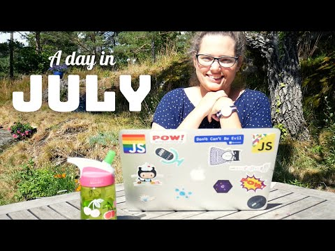
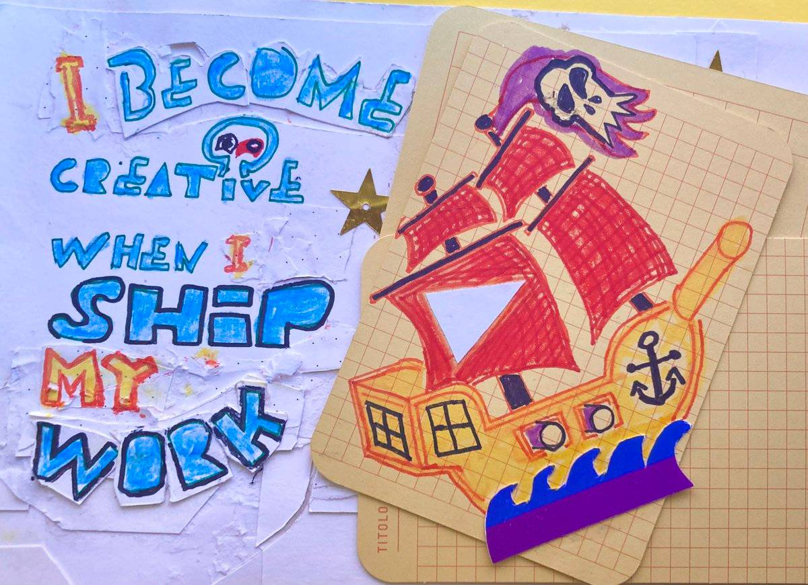

Ahoy Shipmate,

Coming back from Portugal, I am again reminded how much I enjoy workcations and believe you should give it a try if you have a hybrid job:

- You can double your time away time if you work half days
- Working in a new location feels weirdly less like work

I'm also one of those people who need time alone, especially when hanging with large groups. So, being able to retreat to my work is a win-win.

However, for it to be enjoyable for the people around you as well you must overcommunicate:

"I will be working on this trip" might be interpreted as "She will check her email every now and then." If you meant, "I will be on my laptop coding 3-4 hours every day," tension is guaranteed to ensue.

And on that note it's easier for everyone if you keep a consistent schedule. Kids and adults alike thrive on predictability in such matters.

My best workcations have been where I work until 12:00 every day, then properly log off and join in on the vacation activities 🎉

😎

### **Upcoming Mix Pod Voyage**

🎯 Let's jump ship and go with Astro DB\
🗓️ Saturday at 11:00 CET\
📺 Live on [YouTube](https://www.youtube.com/@QueenRaae/streams) and [Twitch](https://www.twitch.tv/queenraae) (yes!)

### **Crew Highlights**

🎂 We celebrated Captain Ola's birthday yesterday!

🥳 Demo ideation is on its way for our first **Build With Us:** any screenshotting via API features you'd like to see us build with [urlbox](https://urlbox.com/)?

🎙️ First Data in the Wild Episode is here: [Permissions, Scopes & Roles with Monica Lent from Affilimate](https://www.datainthewild.fm/episodes/data-in-the-wild-monica-lent/).

🫙 Joined a [panel on the Jamstack](https://www.youtube.com/watch?v=HeOIgsbsbcM), and my [What the Jam](https://youtu.be/QBkIjxX98bE?si=WiBN3YKONJx_8YGP) appearance is live.

📺 Captain Ola has done solo live streams while I worked chillaxed another week in Portugal: [Making a Dev-video, what matters and NOT](https://www.youtube.com/live/h2sqQiO4uGg?si=apFtNEhPG3V7UjL2)!

💡 Tldraw can be saved and viewed inside VS Code, [game changer](https://x.com/raae/status/1780228109364527361)!

☀️ Spring in Portugal showed up, and I found this [year's summer hat](https://x.com/raae/status/1780282724697178583)!

### **From the archives**

A workcation vlog from 3 years ago:

### **Around the Interwebz**

📝 Read this fantastic [intro to databases and indexes](https://stack.convex.dev/databases-are-spreadsheets); if you've ever used Google Sheets (or Excel), you can learn to use a database 🔥

🛠️ Follow [Adam Silver](https://twitter.com/adamsilverhq) to learn how to make better forms!

📺 Salma has [deleted all the slow parts](https://x.com/whitep4nth3r/status/1780603858487750873)!

*I BECOME creative when I SHIP my work. That's why I make YouTube Shorts 🩳*

All the best,\
Queen Raae
