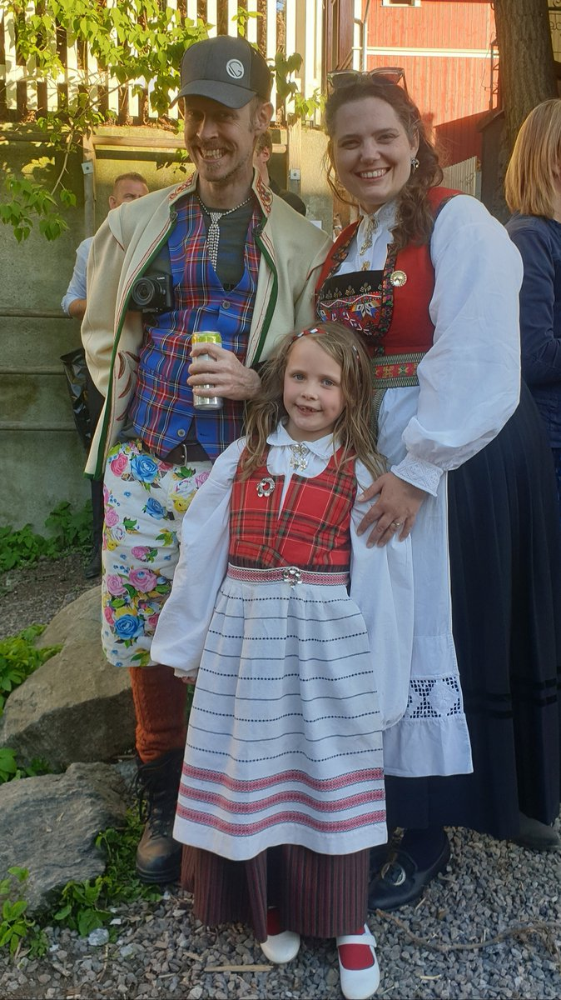
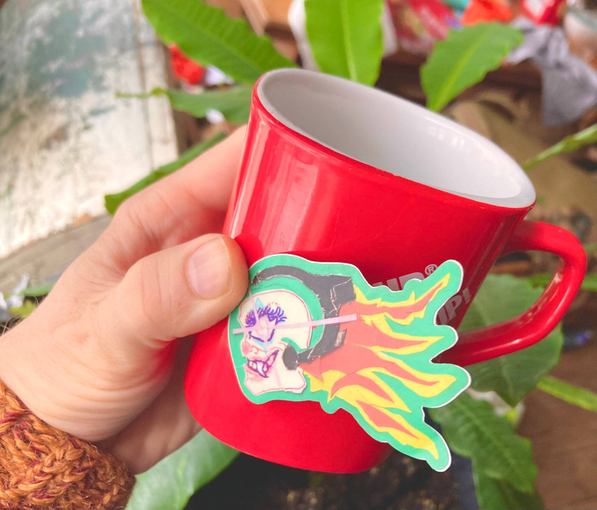

Ahoy Shipmate,

Slow & Steady's next episode, we'll be its 200th 🎉

Join us live to celebrate and [ask questions today at 14:15](https://www.youtube.com/@slowandsteady/live).

We've decided to take this opportunity to reintroduce ourselves and reminisce about favorite guests and changes in our (work)lives.

So it's an excellent episode to start your Slow & Steay journey with if you are not already a listener!

🎙️

### **Upcoming Treasure Hunts**

No MixPod Treasure Hunt this weekend. The Pirate Princess and I are headed to a horse camp tomorrow 🐴 We'll be back on the 18th of May and also probably hit you with some weekday streams before then.

Make sure to subscribe to our [Go Live Reminders](https://queen.raae.codes/emails/preferences/) to be notified!

### **Crew Highlights**

🪚 Ola [built a table](https://youtube.com/shorts/ym2wtoRA_YY?si=4j0yMiUwMqYg_Tdf) at the Pirate Princess' school dugnad.

🏖️ We pitched Urlbox on a [tweets to beach towel](https://x.com/raae/status/1783835479475163352) demo, because "a towel is the most massively useful thing an interstellar hitchhiker a web developer can have" - yeah or neigh?

🎙️ Second Data in the Wild Episode is here: [SaaS Pricing and Data Models with Pierre de Wulf of ScrapingBee](https://www.datainthewild.fm/episodes/pierre-de-wulf-scrapingbee/)

📈 One of my shorts did well: [You're a #millenial if you copy using Ctrl + C instead of clicking the clipboard](https://www.youtube.com/shorts/yNxMSI84qKA)

🚴‍♀️ Got a part-time gig with my favorite product, more in the next one!

📝 Finally found a consistent way of updating Outseta docs: first thing in the morning, together with a support tickets session. Then I move on to project work!

### **From the archives**

The family on the 17th of May a couple of years back; if we are tired on stream on the 18th, it might have something to do with our national day landing on a Friday this year, and that usually means jam session late into the night at the neighborhood potluck.

> The fam in our finest for Norway's Constitution Day! Sun + family + friends makes for a great day 😍
>
> 
>
> — Benedicte (Queen) Raae 👑 (@raae), [May 18, 2022](https://twitter.com/raae/status/1526811316349984768)

### **Around the Interwebz**

📝 William is hiring a [technical content editor for a contract position](https://twitter.com/iChuloo/status/1784966740423688493) at Hackmamba, you?!

🛠️ [Mermaid](https://mermaid.js.org/) is great for adding flowcharts, sequence diagrams, and more to documentation; thanks, Kim, for the recommendation.

📺 Don't be constrained by someone else's productivity system; you could make it any way you like - [even as a cardboard wall](https://youtu.be/6KrvFNrfFGg?si=ka6nNJGuf2oE5ey6).

*Would you like a Jamstack Pirate sticker? Reply with your postal address!*

All the best,\
Queen Raae
