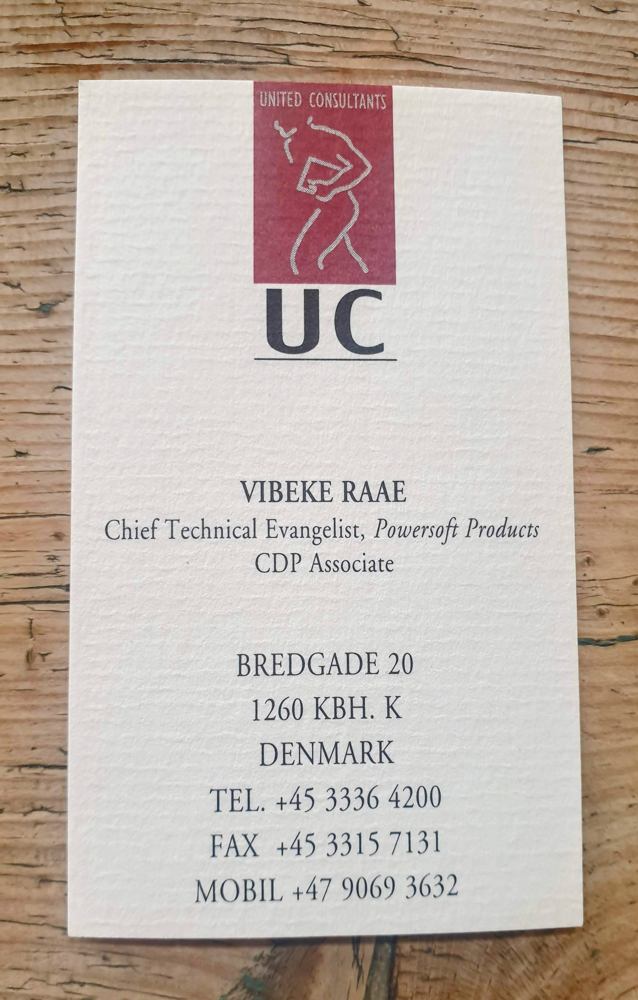

Ahoy Shipmate,

Life is a roller coaster, and I am super duper happy to announce that I get to work with the team behind my all-time favorite everyday product [Whee!](https://www.linkedin.com/company/wheebike/) as their new Fractional CTO 🚴‍♀️ 🎉

What is that you say? It's a fancy term for doing the job of a Chief Technical Officer but in a part-time capacity, and it has a cool-looking acronym: *f*CTO.

I'm in charge of keeping the system alive while continuously making small improvements and looking ahead at what the future holds.

My career path is turning out much closer to my mother's than I intended; she was a dev and a tech evangelist before becoming a CTO for hire 💪

🎢

### **Upcoming Treasure Hunts**

I realized I wrote we'd be back May 18th; what on earth was I thinking? It took many days to rest up after the incredible 17th 🤣

But we'll be back Saturday!

🎯 Let's see!?!\
🗓️ Saturday at 11:00 (AM) CET\
📺 Live on [YouTube](https://www.youtube.com/@QueenRaae/streams) and [Twitch](https://www.twitch.tv/queenraae) (yes!)

Make sure to subscribe to our [Go Live Reminders](https://queen.raae.codes/emails/preferences/) to be notified!

### **Crew Highlights**

🎧 Episode 201 of [Slow&Steady](https://www.slowandsteadypodcast.com/episodes/embracing-the-fractional-life), where I chat about the new *f*CTO gig and embracing the factional life instead of fighting it.

🎙️ Third Data in the Wild Episode is here: [Two-sided Marketplace with Anna Maste](https://www.datainthewild.fm/episodes/anna-maste-subscribe-sense-prev-boondockers-welcome/).

⛵ Ola [trained the Pirate Princess](https://x.com/raae/status/1790682168651370588) for summer sailing with our friend Allister.

🍪 Hosted a brunch + co-working session today with some choice Oslo devs; let me know if you wanna join the next one.

👩‍💻 Got [access to the Framer Plugin Demo](https://x.com/raae/status/1790450818463805546), and I repeat: do not sleep on Framer if you already know React!

🌱 Spent time at the [Greenhouse in Oslo](https://x.com/raae/status/1790057486591885558) with the Whee! gang

🥳 Helped designer [James of Outseta set up his dev environment](https://x.com/raae/status/1793200014845530426), and he created his first PR the same day, and it's already live.

📺 Get yourself [a side project (or three)](https://x.com/raae/status/1790352050183688244) so you can make [YOLO tech decisions](https://x.com/raae/status/1792874015427547557) without convincing yourself it's for a good reason...

### **From the archives**

My mother's old business card ⬇️

### **Around the Interwebz**

🌟 Userlist is looking for a [new part-time support person](https://x.com/benediktdeicke/status/1792840407505854675)!

💡 The founder of [mmm.page keeps having interesting](https://x.com/xhfloz) thoughts and ideas.

📺 [Aaron Francis compared Laravel to React](https://youtu.be/gRtv-BVkwA4?si=wG6SrGCb4TjO9ACu), like comparing Pizza to Pineapples, if you ask me. Turns out that was kinda the point of his video.

*The Pirate Princess's marching band on the way to the Royal Castle*

All the best,\
Queen Raae
