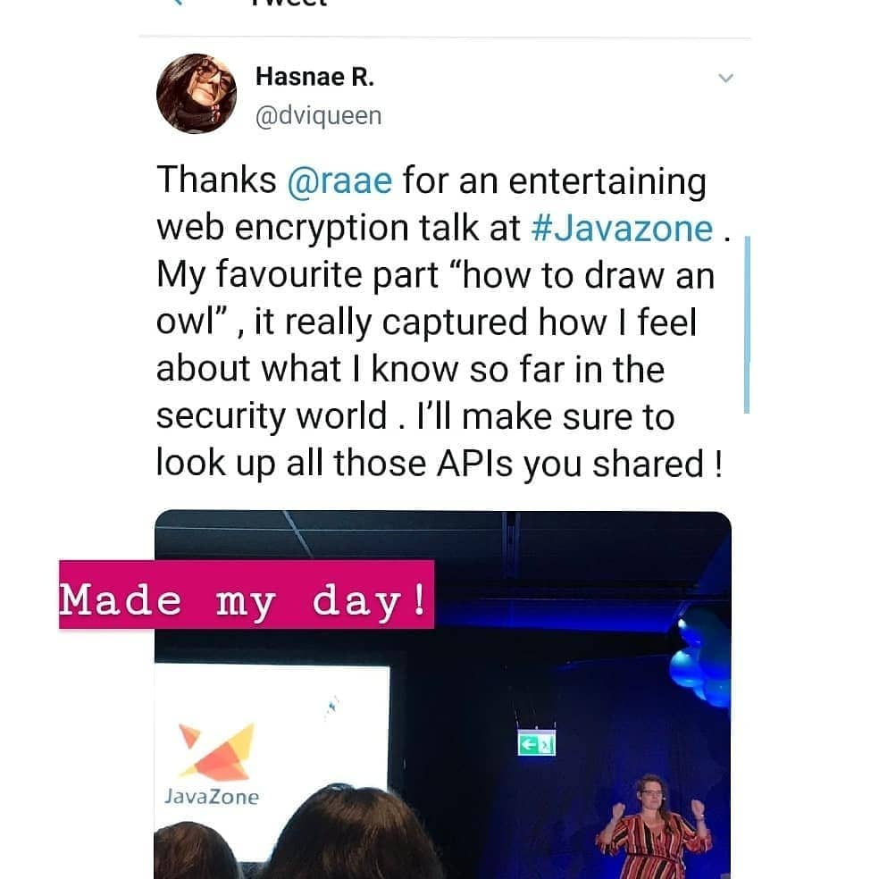
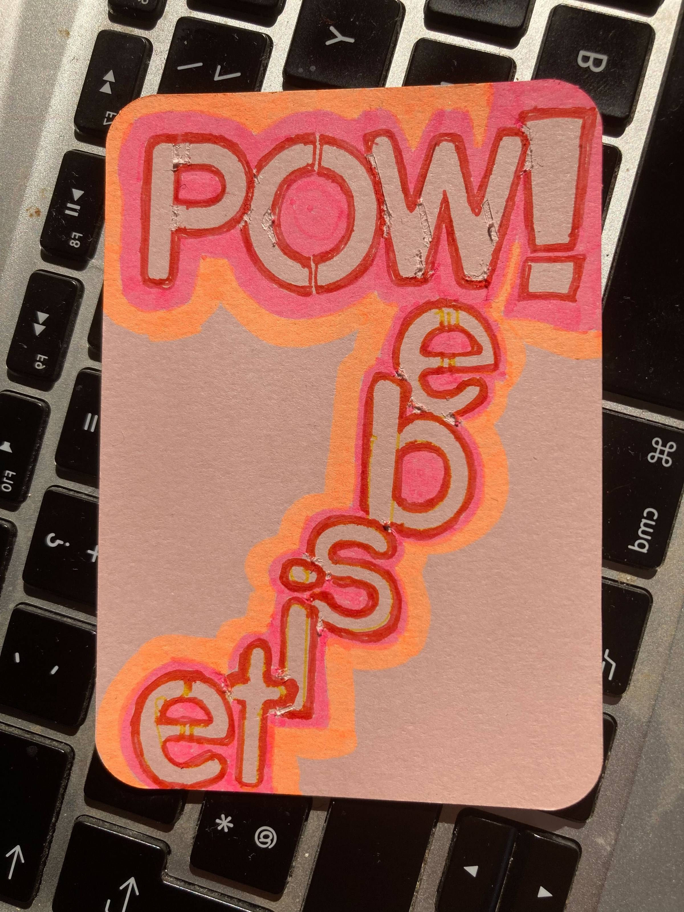

Ahoy Shipmate,

Summer has come and gone—or has it? We are experiencing some kind of heat wave here in Oslo, with temperatures higher than those of a typical Norwegian summer.

As you might know, my mother (the formidable CTO for hire) has early-onset Alzheimer's. She's only 63 and lived next door to us until June! It's taken me relaxing this summer to realize how tired I actually am from caretaking, so you'll probably see me showing up inconsistently here for a while...

However, streaming is one of my energy sources, [so we're back tomorrow](https://www.youtube.com/QueenRaae/live) 🥳

🧘‍♀️

### **Upcoming Treasure Hunt**

Join us [Saturday at 11:00 CET](https://www.youtube.com/QueenRaae/live) as we start our journey from the isle of Gatsby to the isle of Astro onboard the queen.raae.codes 👑

Make sure to subscribe to our [Go Live Reminders](https://queen.raae.codes/emails/preferences/) to be notified!

### **Crew Highlights**

🌱 My focus for the next months is [Lovely Everyday Life,](https://www.slowandsteadypodcast.com/episodes/lovely-everyday-life) and I talked about that in the last episode of [Slow&Steady](https://www.slowandsteadypodcast.com/episodes/lovely-everyday-life) 🎧

💥 Ola is working on moving the POW! marketing pages from Gatsby to Astro; you can see where he's at on [https://pow-site-astro.netlify.app/](https://pow-site-astro.netlify.app/)

🎙️ All the Data in the Wild episodes are released: [Navigating Geodata with Mathias Hansen](https://www.datainthewild.fm/episodes/mathias-hansen-geocodio), [Demystifying DNS with Anthony Eden](https://www.datainthewild.fm/episodes/anthony-eden-dnsimple), [Simplifying Developers’ Lives with Ivar Østhus](https://www.datainthewild.fm/episodes/ivar-osthus-unleash) and [The What, Why, & How of Data Modeling with Dan Singerman](https://www.datainthewild.fm/episodes/dan-singerman-reason-factory).

💪 Secured the last young-folks-with-dementia care home spot (out of 32) in Oslo for my mother. At [Furuset Hageby](https://www.oslo.kommune.no/helse-og-omsorg/omsorgsbolig-og-sykehjem/sykehjem/alle-sykehjem-og-helsehus/furuset-hageby/#gref).

🏕️ We spent a weekend on an island in the Oslo fjord with the Pirate Princess' class, highly recommend!

📺 Ola's has kept up with the short's production; take a look at [coffee & co-working](https://www.youtube.com/shorts/zfBuYth5Ha4) or [degu cage building](https://youtube.com/shorts/FqtMtTBPiUY?si=GZRRiXwr8Nq_1jiZ).

### **From the archives**

JavaZone was on this week, and it made me think back to the inaugural end-to-end encryption talk there in 2019.

See a [full recap of the day on Instagram](https://www.instagram.com/p/B2Tg4wUgncR/?img_index=1).

### Doodle time 🎨

All the best,\
Queen Raae
