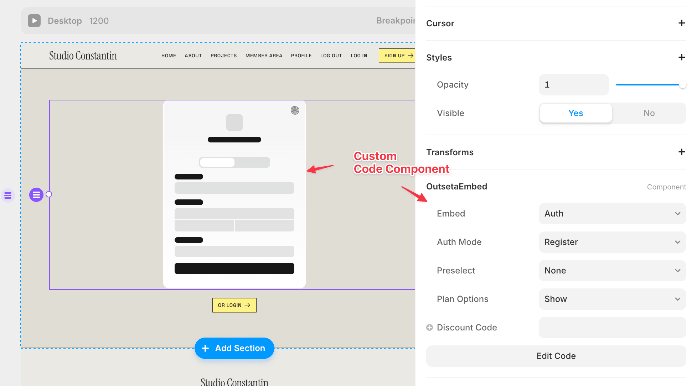

Ahoy Shipmate,

Through my work at Outseta, I’m exposed to all kinds of no-code/low-code apps and site builders. And let me tell you, WYSIWYG\* is not what it used to be.

I am most impressed with Framer at the moment.

It lets creatives build an entire site visually, with animation effects and other fun stuff similar to how they would work in Figma (or so I believe; I am not a big Figma user myself 😬).

“Not that special!” you scream at the screen. “We have many of those: Webflow, Squarespace, Carrd, etc."

But, but, what if I tell you that in Framer, everything on the canvas is a React component that you may wrap in a Higher-Order Component (HOC) to add functionality?!

That feels like the composability we’ve been promised for ages: design encapsulated in the canvas node, additional functionality added by your HOC.

If that does not serve your needs, you can also create standalone “custom components,” aka standard React components that render something on the canvas and get a configuration panel like any other Framer node.

*For the Outseta embeds, we render a placeholder while utilizing the configuration panel.*

It’s still early days, but people are already pushing the boundaries of what is possible in Framer.

We’ll be testing building the next iteration of the Whee! Website in Framer so the design-oriented folks can create it to their pixel-perfect liking while I extend the site with the e-commerce functionality we need.

🎨

If you have Framer experience, I’d love to connect to swap learnings and best practices!

\* WYSIWYG = What You See Is What You Get

### **Upcoming Voyage**

I'm sorry, but the voyages must wait until the new year. The weekends have been about logging off and baking 100+ cookies for the [Christmas Market](https://www.steinerjulemarkedet.no/) at the Pirate Princess’ School.

If you are based in Oslo, come say hi!\
And buy some of our cookies this weekend, no pressure 😆

### **Crew Highlights**

🧑‍💻Is Xano the right fit for Whee? It's grown on me while working on a [Xano + Outseta utility script](https://x.com/raae/status/1856340232007749933) and demo site. Hear more on the latest episode of [Slow & Steady](https://slowandsteadypodcast.com/episodes/too-old-for-fun-and-modular-startup-furniture) 🎧

🚀 The Outseta [Framer plugin](https://www.framer.com/marketplace/plugins/outseta--1ch30ok1fl51lk7of2x58csbp/) I’ve worked on this fall launched. It gives Framer sites membership capabilities: auth, billing, gated content, and more.

🪑 I attended Telia’s startup program with the rest of the Whee team. While I had fun, [I am so done with sitting on “fun and modular furniture”](https://x.com/raae/status/1854077878696104013) 🧓

🎄In preparation for the Christmas market at school, [we’ve baked](https://x.com/raae/status/1853057703364468931) and baked and baked 🍪

🔨Our degus chewed on their [running wheel](https://x.com/OlaHolstVea/status/1856747594481111401), which gave Ola a new project!

### **From the archives**

About a year ago, we started making snippets from our streams, and the interwebz really loved this one —the closest we’ve been to viral so far 😆

[Watch this short on YouTube](https://www.youtube.com/shorts/dxJwhtghCco).

All the best,\
Queen Raae
