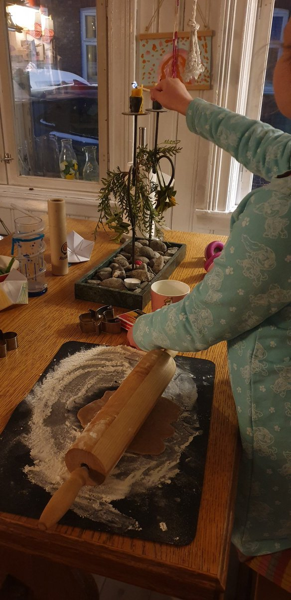

Ahoy Shipmate,

Snow falling on websites is my absolute favorite!

Equal part whimsy, zen, and nostalgic.

So, my Christmas present to you this year is a [platform-agnostic version of the Gatsby Let It Snow plugin](https://github.com/queen-raae/let-it-snow) from 3 years ago.

Paste and watch the snow falling:

```html
<script src="https://cdn.jsdelivr.net/npm/@raae/let-it-snow@latest/dist/snowfall.js" async></script>
```

Or head on over to [outseta.com](https://outseta.com) where designer James even gave the logo a holiday makeover.

❄️❄️❄️

### **Crew Highlights**

🎄We successfully baked over [100 cookies](https://x.com/raae/status/1860369009159360992) for the Christmas market 🍪

👻 Benedikt and I share some debugging horror stories on the latest episode of [Slow & Steady](https://slowandsteadypodcast.com/episodes/debugging-horror-stories) 🎧

💻 Finally finished the [Xano + Outseta (XO) vanilla demo](https://x.com/raae/status/1860039279055155261).

💌 Started the week on a high note with praise from [an Outseta customer](https://x.com/raae/status/1863487730946072718).

🤧 Had the something of the season 😷

🎅 Been to all the [end-of-year celebrations and recitals.](https://bsky.app/profile/raae.dev/post/3ldlt7fu4vk2m)

🚀 Ola is [migrating his blog](https://x.com/OlaHolstVea/status/1861084008525766846) from Gatsby to Astro and the Whee! Store from Wix to Shopify.

### **From the archives**

Three years ago, I also baked a lot for the holidays, even while recording an episode of Slow & Steady.

> And I do talk about baking quite a lot in this one...
>
> [](https://x.com/raae/status/1466062188804771841)
>
> > We (@benediktdeicke and I) might have gone a little overboard in our praise of @stripe... https://twitter.com/SlowSteadyPod/status/1466029381743226881
> >
> > — Benedicte (Queen) Raae 👑 (@raae)
>
> — Benedicte (Queen) Raae 👑 (@raae), [Dec 1, 2021](https://x.com/raae/status/1466062188804771841)

Merry Christmas,\
Queen Raae

PS. I'm on [Bluesky](https://bsky.app/profile/raae.dev), where I finally got to put raae.dev to good use! Reply with your handle, please 🙏
