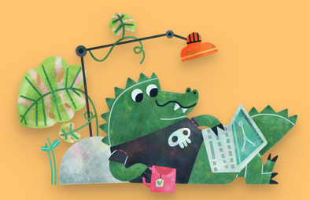

Hello there,

People are raving about how anyone can build apps these days, and we developers are not needed anymore. Because AI!

I'm not so sure about that! Internet friend Justin Jackson of Transistor covers the topic well in [AI isn't going to build your startup](https://justinjackson.ca/ai-build-saas).

However, where I found it to be immensely helpful is in understanding a code base. The other day I needed to implement a new booking flow for Whee!

Telling Cursor.ai to "give me a high-level overview of the booking system in this @codebase works" fast tracked me in finding how to fit in the new flow.

So maybe it's brownfield projects that will benefit the most from this new age?

All the best,\
Queen Raae

### **Crew Highlights**

😃 I feel recharged and productive. Hear more about it on the recent episode of [Slow & Steady](https://slowandsteadypodcast.com/episodes/the-silver-lining-of-a-cancellation) 🎙️

✍️ With the support load down, we finally published our [WeWeb + Outesta integration guide](https://www.outseta.com/guides/how-to-use-wewebs-token-auth-plugin-with-outseta) and a [companion expansion guide](https://go.outseta.com/support/kb/articles/L9Pw2jQJ/integrate-weweb-with-outseta).

👨🏼‍💻 Ola's [learning to add validation](https://x.com/OlaHolstVea/status/1893267690569027613) on his app on Laravel Cloud

🧓🏻 These [items at the technical museum](https://x.com/raae/status/1892588411422232761) will make your back hurt

📵 Ola's been on a [digital detox](https://www.youtube.com/shorts/9V88xlWO6B4) these past couple of days

🏗️ We published a rudimentary landing page for our new idea [Galleon](https://galleon.tools/) **—** Unlock the Treasure of User Data on Your Webflow Site

### **From the archives**

Last year, we joined Amy Dutton's #TwoWeekBuild challenge to create [datainthewild.fm](https://www.datainthewild.fm/). Still love the quicky brand.

> Gonna build a site for the Data in the Wild podcast as my #TwoWeekBuild with @selfteachme!\
> Not coding until the official start on March 1st, but found my design inspiration on @icons_8 today 🏴‍☠️
>
> 
>
> — Benedicte (Queen) Raae 👑 (@raae), [Feb 23, 2024](https://x.com/raae/status/1761107715416322173)
