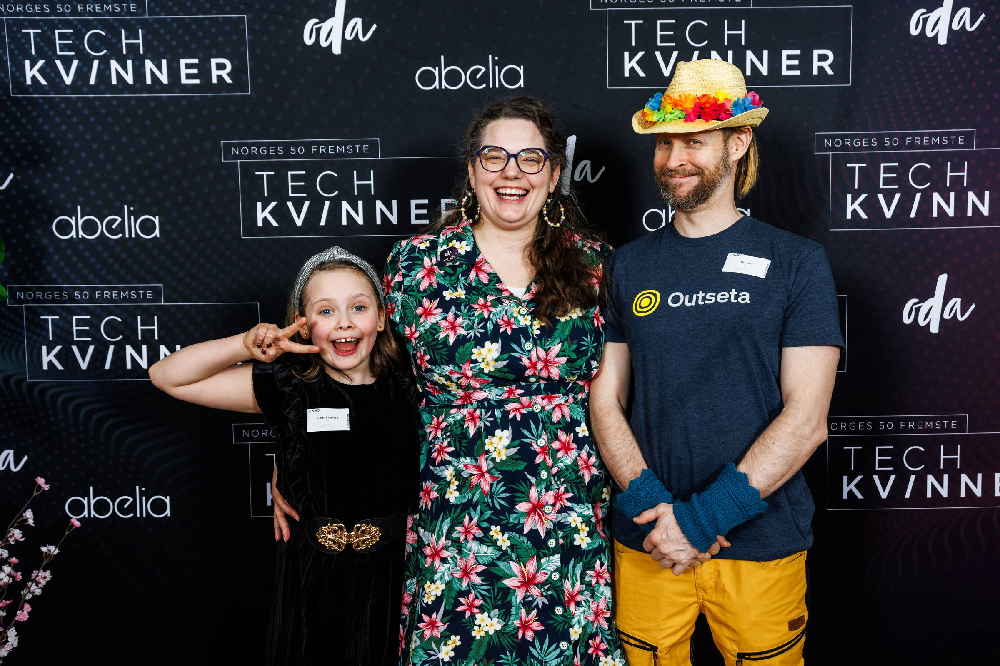
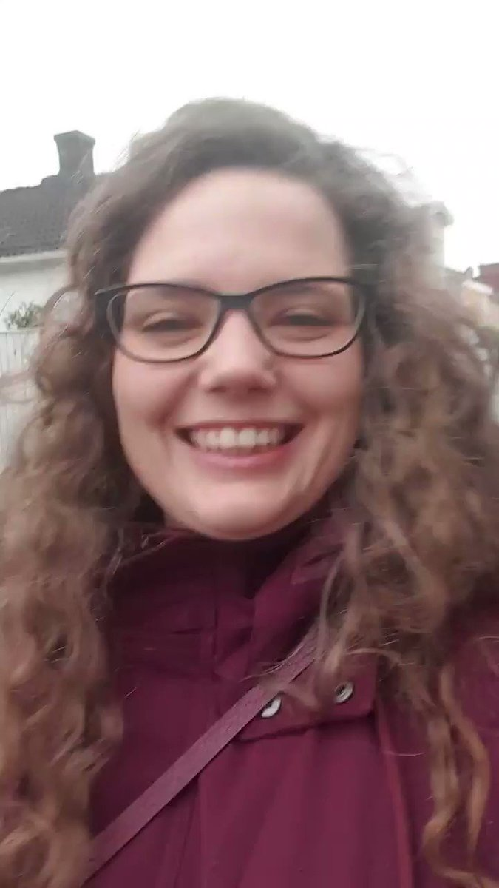

Hello there,

When you grow up with a developer/CTO mom and her friends, choosing tech isn't a brave choice. It's just a standard choice...

And THAT, folks, is the value of visible role models!

So I try to be one, and being honored as one of Norway's 50 leading tech women helps fuel the fire!

But even so, I had my mind set on being a graphic designer. Another role model, my cool young aunt, was an industrial designer, and as a teenager, I read [Naomi Klein's No Logo](https://en.wikipedia.org/wiki/No_Logo).

My plan: get into advertising and use its powers for good... 👊

So I am forever grateful to my high school teacher, Karsten, who patiently nudged me over the edge into applying to the Norwegian University of Science and Technology.

Thank you Karsten 🙏\
I am having so much fun 🤩

All the best,\
Queen Raae

### **Crew Highlights**

🎥 A video of me was played at the award show, [you may watch it on LinkedIn](https://www.linkedin.com/posts/abelia_benedicte-raae-livestreamer-koding-p%C3%A5-internett-activity-7305510397208326144-fQ0a?utm_source=share&utm_medium=member_desktop&rcm=ACoAAABUPDQBwqcq85lyWTcn4sT4zORSBsiQeqg).

🧗‍♂️ My Pirate family has picked up a new sport and you can hear more about it on the recent [Slow & Steady](https://slowandsteadypodcast.com/episodes/finish-it-and-ship-it-mode) episode 🎙️

👩‍💻 I spent last Friday [coding a feedback/roadmap app](https://x.com/raae/status/1898668192714703166) using Lovable and forcing it to use Outseta for auth (we need to make this easier) and Supabase.

🎨 Ola's helping the Pirate Princess learn more about Tailwind classes by [playing around with our pages](https://x.com/OlaHolstVea/status/1898404845356453949)

🔊 The Pirate Princess turned our kitchen into a [sound studio](https://x.com/raae/status/1895526253954019468) to record the correct crunch sound for her stop motion movie soon to premiere on YouTube.

### **From the archives**

POW! celebrates its 5th birthday this year 🎂 Want to help give POW! a dev and marketing push? Reach out. This fall, I need to make a decision about its future...

> Dear POW!
>
> Happy international women's day 💪🏻
>
> POW! is live and I suddenly have a pang of "it's not good enough yet".
>
> But here it is https://www.usepow.app.
>
> And it's a web app so improvements will be happening continuously.
>
> #usepowapp
>
> 
>
> — Benedicte (Queen) Raae 👑 (@raae), [Mar 8, 2020](https://x.com/raae/status/1236567073511411713)
