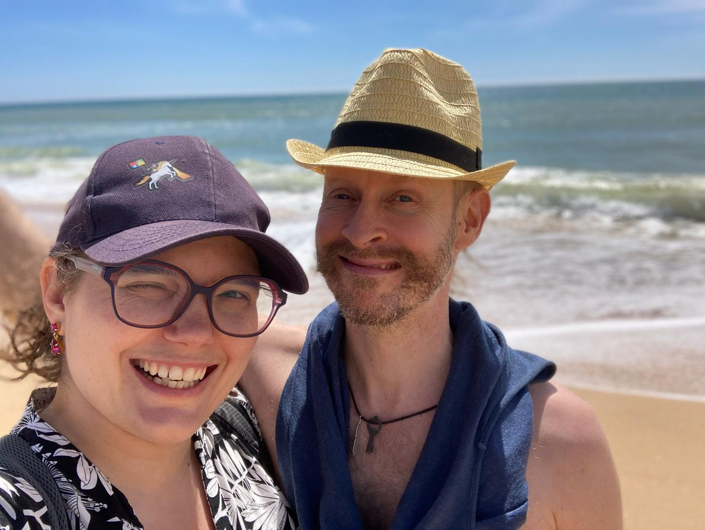

Hello there,

First minimal version of [Galleon Attributes](https://github.com/queen-raae/galleon-attributes) is out!

It lets you fetch and render data using data attributes only. It's built for Webflow, but should work just as well with Carrd, mmm.page, and other site builders that let you play with data attributes.

Add the script to your Webflow project, sprinkle in a few data attributes like gl-get and gl-bind, and watch your static content come alive with data from any API.

Galleon Attributes will be an open-source project intended to work well with our upcoming Galleon Gateway:

> A middleware service sitting between authentication providers (like Outseta, Memberstack, Clerk, Auth0) and no-code data providers (like Airtable, Notion, Google Sheets). It adds access control capabilities to data sources that typically have an all-or-nothing approach to data served by their APIs.

Is this the genius idea I think it is?\
I wanna hear your unfiltered thoughts...

All the best,\
Queen Raae

### **Crew Highlights**

✨ Benedikt and I got AI to help out with our respective projects. Find out more about them in our latest [Slow & Steady episode](https://slowandsteadypodcast.com/episodes/getting-some-help-from-ai) 🎧

🎮 I started a new gig, which means [new colleagues and new fun](https://x.com/raae/status/1902748987376992449)!

🧗‍♂️ [Climbing](https://x.com/OlaHolstVea/status/1903482258553553032) is becoming a regular part of our family routine

🎨 [James shipped a little UI refresh](https://x.com/outseta/status/1902465333031833764) to make Outseta looking fresh and clean

🐛 Here's one thing AI can't help you with: [timezone bugs](https://x.com/raae/status/1905595915500413172)!

### **From the archives**

Last year, we celebrated our anniversary in Portugal!

Super looking forward to our summer sailing adventure. Leaving June 10th and aiming for Portugal by the end of August ⛵

> Anniversary lunch date on the beach while the Pirate Princess went to the water park with my sister: 10/10 would do again 😍
>
> 
>
> > Celebrating 15 years with Captain @OlaHolstVea today!\
> > The photo is one of my favs 😆 It's from our 3rd-anniversary lunch date on Hydra. We spent that easter sailing around the Greek islands with a group of friends.\
> > #PirateDevLife
> >
> > — Benedicte (Queen) Raae 👑 (@raae)
>
> — Benedicte (Queen) Raae 👑 (@raae), [Apr 6, 2024](https://x.com/raae/status/1776532792530055505)
