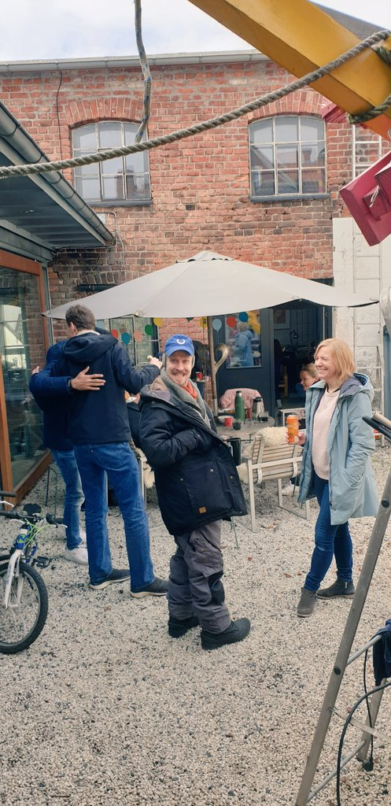
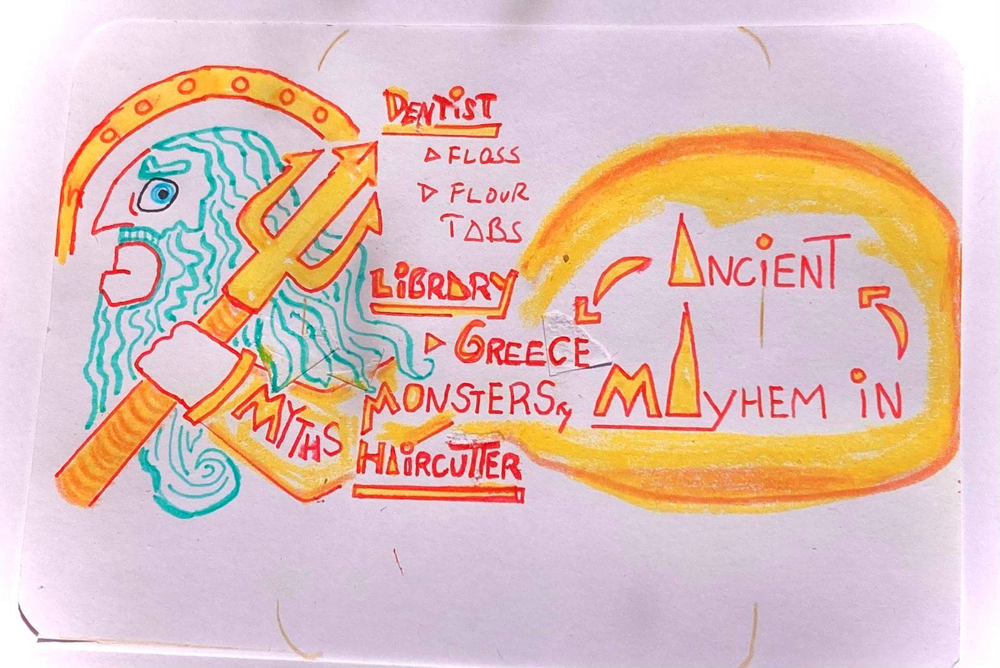

Hello there,

We're going on a very on-brand (😆) adventure this summer.

June 10th, we set sail from Drøbak (Norway) towards the Mediterranean with Allister, whom Ola met in the Caribbean 26 years ago, at the helm.

Our journey will be 11 weeks with plenty of time to enjoy wherever we anchor. If you live on the coast of southern England, northern Spain, or Portugal, let us know so we can meet up 🎉

The plan is to digital-nomad it 😬 Stick around for an honest assessment of how that goes and for reports from the open sea.

All the best,\
Raae

### **Upcoming Voyage**

Join us in cloning the Feedback Fort: Outseta + React + Supabase Starter to make a voting system. The plan is to build the Feedback Fort in multiple stacks, so why not go meta and use the first start one to let Outseta's user vote for the next one 🤪

📆 May 12th at 15:30 CEST\
📺 [Watch live on YouTube](https://www.youtube.com/live/1kiXr7QMqLs)

### **Crew Highlights**

🎙️ Here's your sign to do those customer interviews before jumping into code. Benedikt and I talk more about this on the [latest Slow & Steady episode](https://slowandsteadypodcast.com/episodes/don-t-code-the-thing-talk-to-people-first)

💬 Speaking of interviews, we're looking for Webflow builders working on customer/membership portals. They'll receive a gift card in exchange for their time. [More details here](https://x.com/raae/status/1919093707703308696)

📝 Here's how you can [use JWT from any auth provider with Supabase RLS](https://queen.raae.codes/2025-05-01-supabase-exchange/)

🏰 I've completed [Feedback Fort for Outseta](https://x.com/raae/status/1919681755583316180), a demo app you can fork

🎥 [Learn why Alissia chose Outseta for their client's Webflow site](https://x.com/raae/status/1917875181046861929)

### **From the archives**

Here's more proof that Nordic weather is crazy 🤪 Two years ago, we had a spring BBQ in the middle of the rain 🌦️

> At one point there was even sun ☀️ However I didn't manage to capture that 😬
>
> 
>
> > Day of May 1st BBQ:\
> > The universe: "I was just kidding, no more spring for you" 🌧️🌨️\
> > Me: I got umbrellas and wool clothes. This BBQ is still on ☔💪
> >
> > — Benedicte (Queen) Raae 👑 (@raae)
>
> — Benedicte (Queen) Raae 👑 (@raae), [May 1, 2023](https://x.com/raae/status/1653091421023354894)

### **Sketchnote by Ola**

*The Pirate Princess (10) and Captain Ola had a day off to visit the dentist. The dentist said flossing is IMPORTANT and to take fluoride tablets. We went to our local library and got Myths, Monsters and Mayhem in Ancient Greece. Then the Pirate Princess cut her hair shorter in preparation for the sail trip.*
