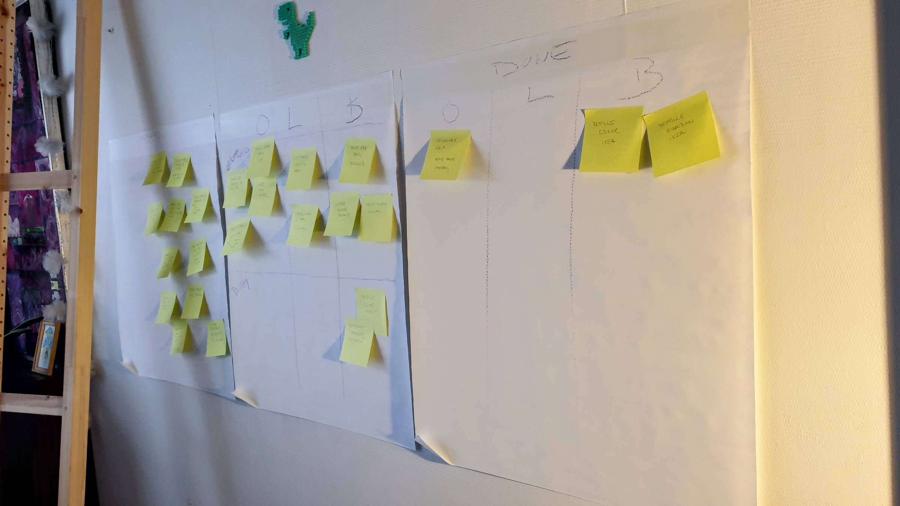

Hello there,

A tad bit overwhelmed over here getting ready for our 11-week sailing adventure. Packing for that alone would be okay, but we are also taking advantage of the house being empty to remodel, so we must pack away almost all our belongings....

Cue, my CTO mom's favorite tool for aligning a team and getting things done: physical planning on a wall (or a door or a window or anywhere that makes sense to you).

It doesn't have to be pretty to work!

While recording today, Benedikt shared his story of doing the same on a glass door for his sister's wedding.

Have you tried? In or outside work?

All the best,\
Raae

### **Upcoming Voyage**

Join us in adding user avatars to our [FF Tech Stacks](https://tech-stacks.netlify.app/), ie, a semi-sync of Outseta user data.

📆 Today at 15:00 CEST\
⏰ 30 min earlier than last time\
📺 [Watch live on YouTube](https://www.youtube.com/live/1kiXr7QMqLs)

### **Crew Highlights**

🎙️ Reviewing my plan for the year with my slow business group made me realize that Galleon is hitting many of my goals from the beginning of the year! Hear more about them on the [latest Slow & Steady episode](https://slowandsteadypodcast.com/episodes/naming-colors-is-hard)

📝 Did you know [UPDATE requires SELECT Row Level Security (RLS) permissions in Postgres/Supabase](https://queen.raae.codes/2025-05-10-rls-update-select/)?

📝 And that AI is as [prone to the "client-side validation is enough" fallacy](https://queen.raae.codes/2025-05-19-ai-client-side-only/) we often see with human developers? AI is trained on human-written code after all.

🙀 [Our cat Smidig](https://x.com/OlaHolstVea/status/1922924923581858251) joined one of our livestreams and got jealous...

🎉 [Ola just finished his first wave of interviews](https://www.youtube.com/shorts/hYKhGZYlalI)

### **From the archives**

Two years ago, I visited my alma mater in Trondheim to serve as an external reviewer of their master's IT program.

That visit definitely took me back to the early 2000s 😄

> Not much had changed since my uni days in Trondheim...not even the entertainment...pretty sure I went to a 50 Cent concert at @UKA my first semester in town back in 2023...
>
> 
>
> — Benedicte (Queen) Raae 👑 (@raae), [May 23, 2023](https://x.com/raae/status/1660768965121957893)

### **Family life**

*Say hello to the magician Rolf Gunnar, The Pirate Princess's alter ego, on stage for her circus performance at Oslo Ung theater festival this weekend.*
