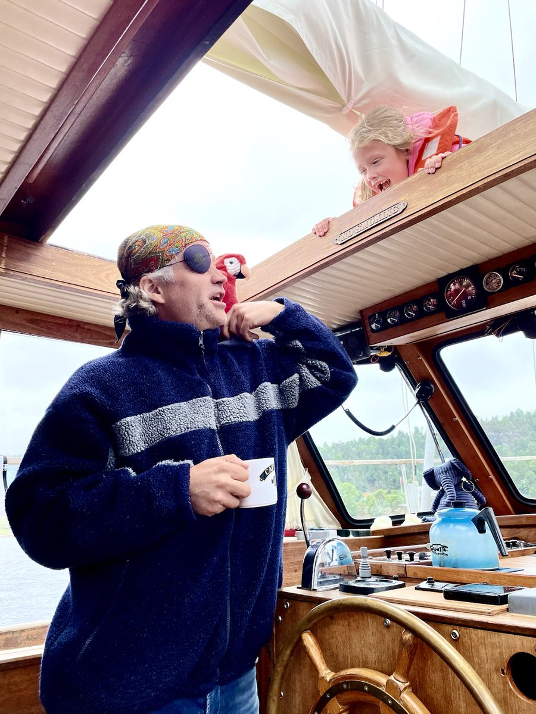

Hello there,

Writing this from our impromptu vacation to the west coast of Norway, pulled together after jumping ship two weeks into our sailing adventures.

I could probably make this into a cringy LinkedIn-style essay about "how to know when to quit" or "when to pivot your SaaS".

But this summer is too hot for profound insights... 🥵

Hope you are having a blast!

All the best,\
Raae

### **Upcoming Schedule**

Join us for a summer Slow&Steady update

📆 Tomorrow/Tuesday\
⏰ at 15:00 CEST\
📺 [Watch live on YouTube](https://www.youtube.com/@slowandsteady/live)

### **Crew Highlights**

🎙️Hear more about us jumping ship on the [latest episode of Slow & Steady](https://slowandsteadypodcast.com/episodes/pivot)

🚀 [Outseta's Laravel package is now live](https://github.com/refbytes/laravel-outseta)

📍 [Had a solid work session during our layover in Sweden](https://bsky.app/profile/raae.dev/post/3lrgqe23qb224)

⚓️ [The Pirate Princess got to steer the ship with Captain Allister](https://x.com/OlaHolstVea/status/1933151909411803641)

🛳️ [We boarded the Color Fantasy to return to good old Norway](https://x.com/OlaHolstVea/status/1936389575783416123)

### **From the archives**

Four years ago, we also took the Pirate Princess on a pirate ship during a mini-vacation 🏴‍☠️

> What a magnificent and piratical mini-vacay 🏴‍☠️ https://twitter.com/raae/status/1408514417940119552
>
> 
>
> > Sailing on a real pirate ship for the next few days with @OlaHolstVea and the Intern, but I will be back on this here app next week to do a proper sales launch for #GatsbySummerFunctions 🏴‍☠️👑 https://twitter.com/raae/status/1402225214071660554
> >
> > — Benedicte (Queen) Raae 👑 (@raae)
>
> — Benedicte (Queen) Raae 👑 (@raae), [Jun 29, 2021](https://x.com/raae/status/1409827036781285381)
