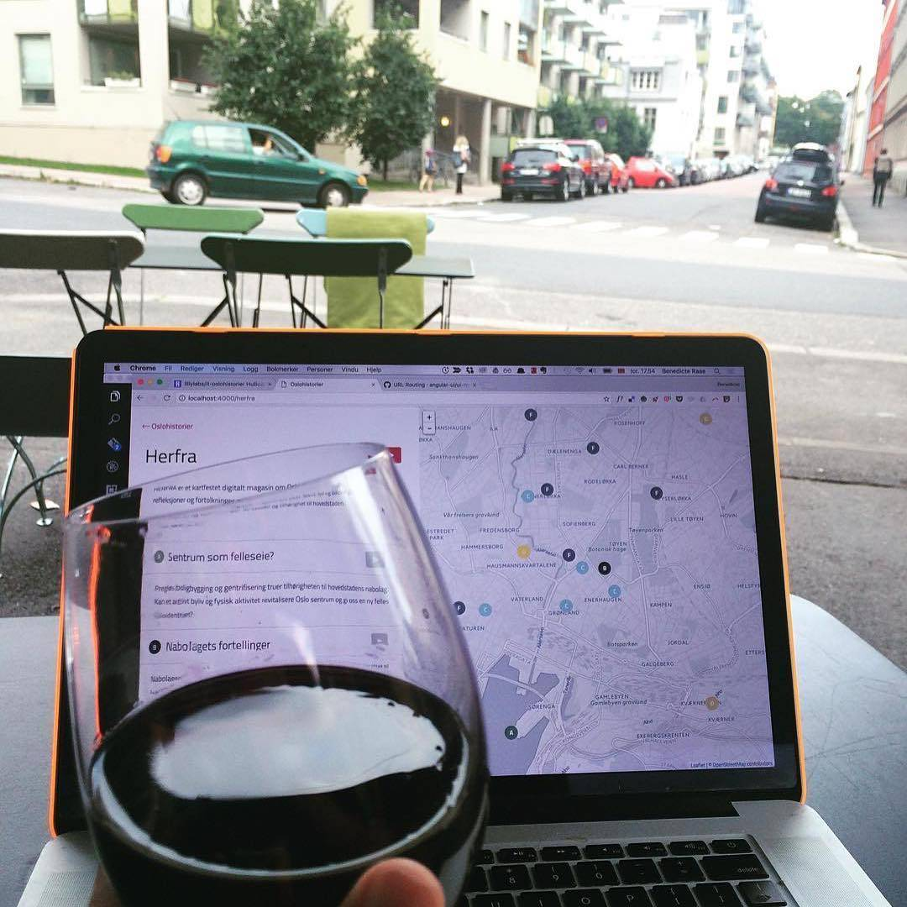
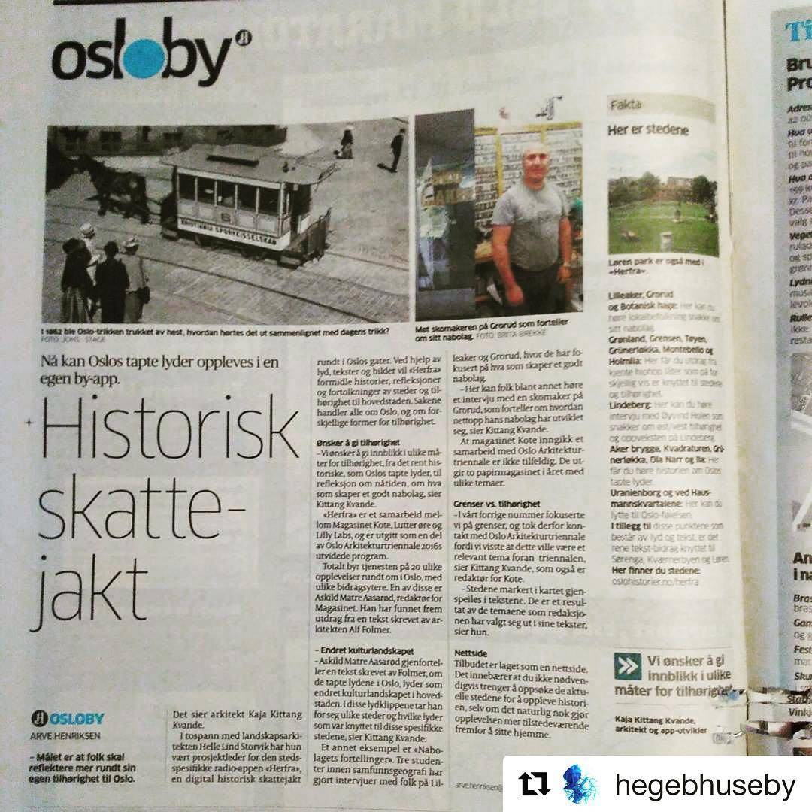
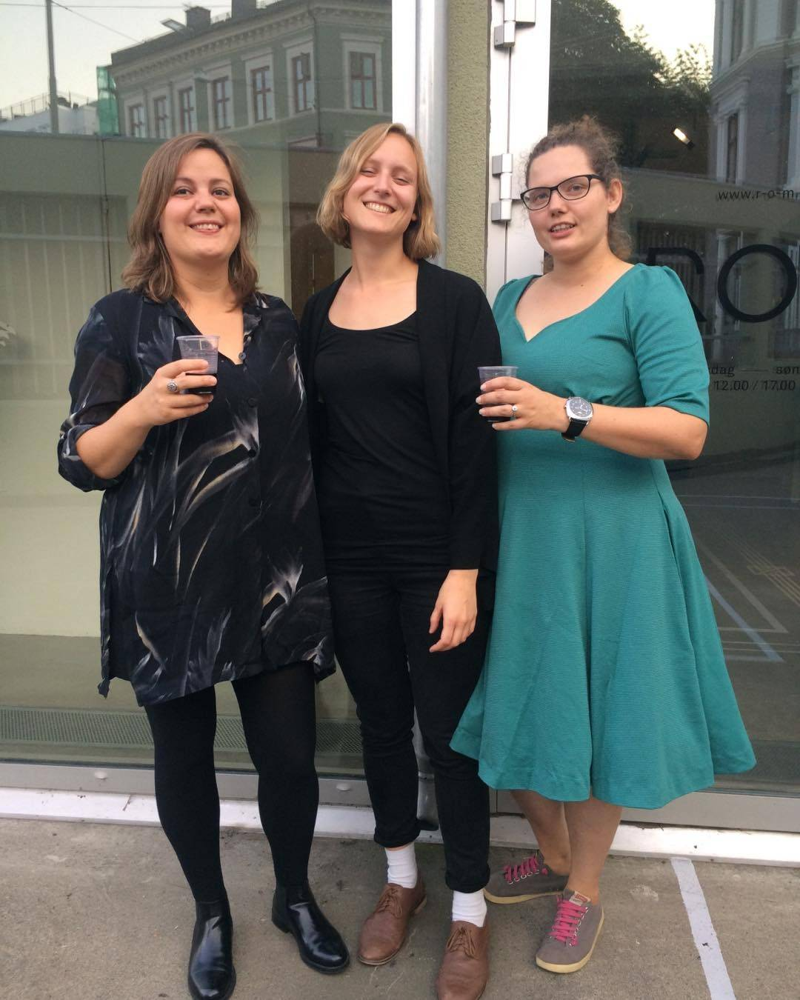

Hello there,

Way back when, in internet years, we looked into building a solution for location-based audio guides.

At the time, everyone wanted (native) apps, and how to scan a QR code was not yet ubiquitous knowledge.

So we left it be...

However, with our current focus on family-product fit and the widespread adoption of QR codes, it's back on the table!

We're in the validation phase, so if you know anyone connected to **local heritage museums** or **large sculpture parks,** I'd be forever grateful for an introduction.

All the best,\
Raae

PS: Thanks to the power of static sites, our old demo [oslohistorier.no](https://oslohistorier.no) is still up.

### **Upcoming Schedule**

Join us for a Slow&Steady recording!

📆 Today (Tuesday)\
⏰ at 15:15 CEST (in 15 min)\
📺 [Watch live on YouTube](https://www.youtube.com/@slowandsteady/live)

### **Crew Highlights**

🎧 Hear more about Omway on the [latest episode of Slow & Steady](https://slowandsteadypodcast.com/episodes/ship-it-already)

📋 Here's our [definition of family-product fit](https://x.com/SlowSteadyPod/status/1956238459279986781)

✉️ [Our game plan for the next couple of days](https://x.com/SlowSteadyPod/status/1960975817762066824)

💻 [I created an MCP server for Outseta](https://x.com/raae/status/1958804854647783620)

😆 [AI is forever your biggest cheerleader](https://x.com/raae/status/1954625381815763421)

🤖 [Vibe coding is actually the gateway to something else](https://x.com/outseta/status/1957505112194105635)

### **Blast from the past**

Photos from nine years ago (2016) when we launched [oslohistorier.no](https://oslohistorier.no) with Lutter Øre.

*Done!*

*It got some press!*

*Social media posing was as non-ubiquitous as QR codes at the time 😆*
