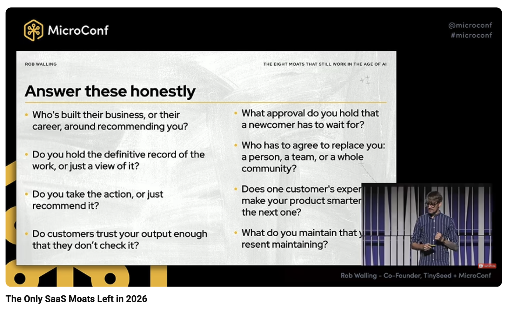

I found this to be a level-headed take on the whole SaaS is dead debacle that has been floating through our community, and the world in general.

I LOL'ed hard at one of the first slides stating "Everyone gets AI" as it reminded me of this meme from the olden days of the internet. "You get a car, and you get a car"

The moats summarized as questions for the founder:

However I do recommend watching the full talk for the structured approach to what "AI will come for you SaaS" actually means **[structured as 10 attacks](https://www.youtube.com/watch?v=KpILHX2D-AA)**.
