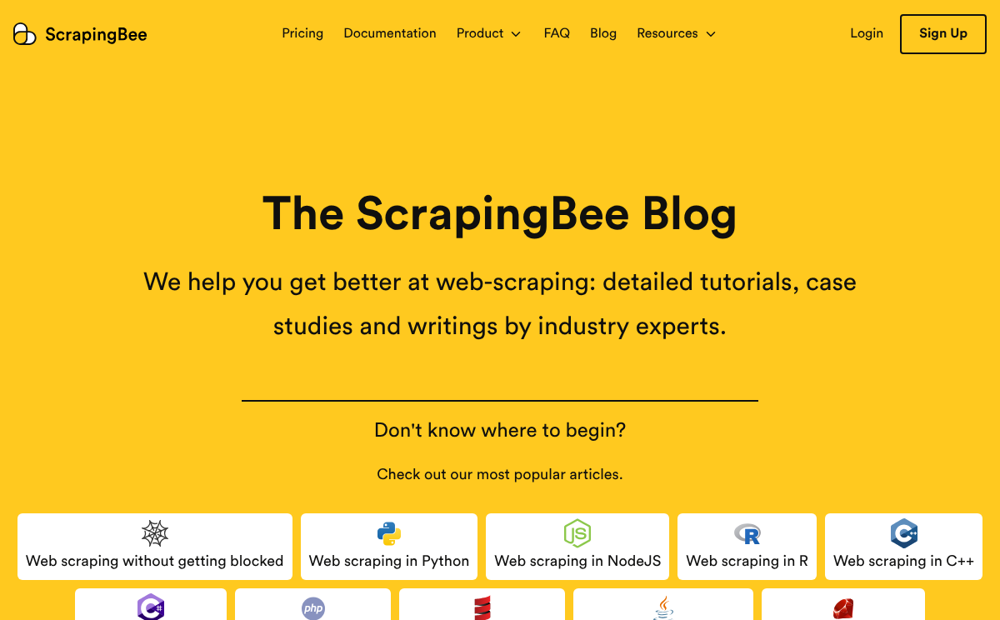
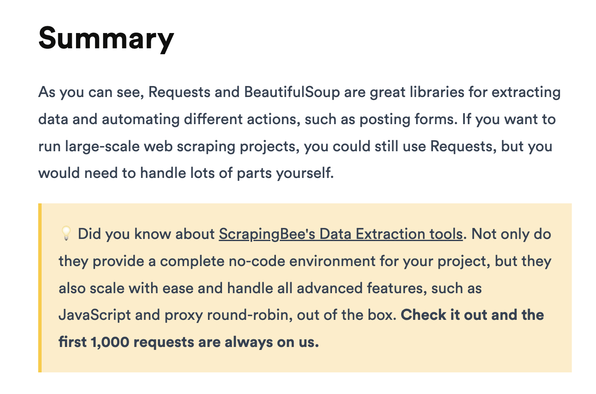

I am writing this up as I keep suggesting it to founders.

Today included, over lunch with Svein.

It's not something I have personal experience with (yet), but something I know has worked really well for a company I admire, ScrapingBee.

Their blog is full of tutorials on how to scrape the web without their product. But with an undertone of "you'll need us at some point and when you do, we'll be here".

And I think it's even more potent now that anyone believes they can prompt their way to a free copy of any tool.

Pierre of ScrapingBee talked to us about the strategy at the 38 minute mark of [Slow & Steady episode 140](https://slowandsteadypodcast.com/episodes/scrapingbee-with-pierre-de-wulf). They saw "a big opportunity in writing good, actually good and interesting web scraping tutorials for developers". Not the kind with a trial or a coupon every two paragraphs.

<iframe width="100%" height="180" frameborder="no" scrolling="no" seamless="" src="https://share.transistor.fm/e/1f49be28?#t=38:30"></iframe>

Here's what that looks like. Their blog has a tutorial for just about every language, and each one actually teaches you to scrape the web yourself. [The Python one](https://www.scrapingbee.com/blog/web-scraping-101-with-python/) is a 30 minute read.

Then, when you're done, one yellow box: if you'd rather not run all of this yourself, we're here, and the first 1,000 requests are on us. This is how it looked in 2022, when we recorded with Pierre:

As anyone who's been around the web block a time or two knows, scraping is a hard problem when you want to do it consistently and at some scale.

But depending on your ideal customer, even less technically hard problems can become annoying and take time away from their core business.

Once the new-toy feeling wears off, I believe they will find that stewardship of what they vibed does not fall within their genius zone.

And what better tool to choose than the one whose tutorial their AI used to vibe code their free version?!

So get teaching:

Sell scheduling? Teach how to build a booking form yourself.

Sell uptime monitoring? Teach how to check your site with a cron job.

It might be their AI reading the tutorials first, but long term I think it will land them in your tool.
